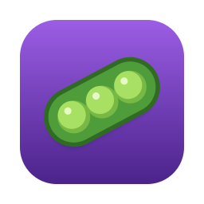

<div align="center">



# Podman Tray

**Seus containers do Podman na barra de menu. Sem abrir o terminal.**

Um app leve, escrito em Go, para **macOS, Linux e Windows**: veja o que está rodando, inicie, pare, abra logs e shell, e receba um alerta quando um container cair.

[](https://github.com/stolato/podman-tray/releases/latest)
[](https://github.com/stolato/podman-tray/actions/workflows/build.yml)


[](LICENSE)

[**⬇️ Baixar**](https://github.com/stolato/podman-tray/releases/latest) · [Recursos](#recursos) · [Instalação](#instalação) · [Problemas comuns](#problemas-comuns)

</div>

<!-- TODO: adicionar uma captura do menu aberto, ex.:  -->

## Por que usar

Para o dia a dia, abrir o terminal (ou uma interface completa) só para ver se um container está de pé ou reiniciá-lo é demais. O Podman Tray fica quietinho na barra de menu e resolve o que você faz o tempo todo:

- 🟢 **Status de relance**: o ícone ganha uma bolinha verde quando algo está rodando, e o menu mostra `rodando/total`
- ⚡ **Ações em um clique**: start, stop, restart, pause, logs, shell, inspect e remover
- 🧩 **Entende compose e pods**: containers do mesmo projeto ficam agrupados, com iniciar/parar o grupo inteiro
- 🔔 **Alertas**: avisa quando um container cai ou fica *unhealthy*
- 🌐 **Portas clicáveis**: `localhost:8080 → 80/tcp` abre direto no navegador
- 🪶 **Leve**: um único binário, sem Electron; atualiza via `podman events` em vez de ficar consultando
- 🌍 **Em português e inglês**: segue o idioma do sistema

## Recursos

**Containers**

- Lista de `podman ps -a` com status: 🟢 rodando, 🟠 *unhealthy* (healthcheck falhando), 🟡 pausado/reiniciando, ⚪️ parado, 🔴 erro, ⏳ ação em andamento
- Submenu por container com **CPU/memória**, imagem e portas clicáveis (UDP aparece, mas não é clicável)
- **Start**, **Stop**, **Restart**, **Pause**/**Unpause**
- **Logs…** (`logs -f`), **Shell…** (`exec -it`, com `bash` se existir, senão `sh`) e **Inspect…**, abertos num terminal
- **📋 Copiar** ID, nome e URLs das portas
- **🗑 Remover…** (`rm -f`), com confirmação
- **Iniciar todos** / **Parar todos**, em paralelo, com uma única notificação de resumo

**Grupos (compose e pods)**

- Containers de um mesmo projeto do compose (label `com.docker.compose.project` ou `io.podman.compose.project`) ou de um mesmo pod aparecem juntos como `🟢 projeto (2/3)` (🟢 todos rodando, 🟡 parte, ⚪️ nenhum, 🟠 algum *unhealthy*)
- **Iniciar grupo** / **Parar grupo**: pods usam `podman pod start/stop`; projetos do compose agem em cada container
- **🗑 Remover pod…** (`podman pod rm -f`) ou **🗑 Remover containers…** do projeto do compose, com confirmação. Não é um `compose down`: redes ficam, e volumes nunca são apagados

<details>
<summary>Detalhes do agrupamento</summary>

Se o container tem projeto e pod ao mesmo tempo (o `podman-compose` cria um pod `pod_<projeto>`), vale o projeto. Containers *infra* dos pods não aparecem. Remover os containers de um projeto do compose também remove o pod `pod_<projeto>`; como o app não tem o arquivo do compose, um `compose up` recria tudo.

</details>

**Alertas e notificações**

- Notifica quando um container **cai** (sai com código diferente de 0 sem ter sido parado por alguém; falta de memória aparece como OOM) e quando fica **unhealthy**
- No máximo um alerta a cada 5 min por container, para um loop de restart não inundar as notificações
- Notificações nativas ao concluir ações ou em caso de erro. **⚙️ Opções → Notificar ações concluídas** desliga as de sucesso; erros e alertas continuam
- Se as notificações do app estiverem desligadas no sistema, o menu mostra **🔕 Notificações desativadas, abrir configurações**

**Podman machine**

- Estado (🟢 rodando, 🟡 iniciando, ⚪️ parada), nome, CPUs e memória
- **Iniciar** / **Parar**, com confirmação antes de parar

**🧹 Limpeza**

- Espaço usado por imagens e volumes (`podman system df`)
- **Remover imagens sem uso…** (`podman image prune --all`) e **Remover pods vazios…**, com confirmação. Volumes guardam dados, então não há limpeza deles pelo menu

**Outros**

- **⚙️ Opções → Abrir ao iniciar sessão**, nos três sistemas
- **⬆️ Aviso de nova versão**: consulta o último release no GitHub ao abrir e uma vez por dia
- Ícone que segue o tema claro/escuro no macOS
- Interface em português ou inglês, conforme o idioma do sistema. Para forçar um deles, abra o app com `PODMAN_TRAY_LANG=en` (ou `pt-BR`)

## Instalação

Requer o [Podman](https://podman.io) instalado. Baixe o pacote do seu sistema no [**último release**](https://github.com/stolato/podman-tray/releases/latest). Para conferir o download, baixe também o `SHA256SUMS` e rode `shasum -a 256 -c SHA256SUMS --ignore-missing` (no Windows, `Get-FileHash` no PowerShell).

Se o app já estiver aberto quando você instalar o Podman, ele o encontra sozinho em alguns segundos, sem precisar reiniciar.

### macOS

Requer macOS 12 ou superior e uma Podman machine. Binário universal (Apple Silicon + Intel).

1. Baixe `Podman-Tray-<versão>.dmg` e arraste o app para **Aplicativos**.
2. O app não é notarizado pela Apple, então o Gatekeeper bloqueia na primeira vez. Libere em **Ajustes do Sistema → Privacidade e Segurança → Abrir Mesmo Assim**, ou rode:
   ```bash
   xattr -dr com.apple.quarantine "/Applications/Podman Tray.app"
   ```

Na primeira execução o macOS pede permissão para enviar notificações e, na primeira vez que usar **Logs…**, **Shell…** ou **Inspect…**, para controlar o Terminal.

<details>
<summary>Compilar a partir do código</summary>

Com Go 1.27+ e as Xcode Command Line Tools:

```bash
git clone https://github.com/stolato/podman-tray.git && cd podman-tray
make install     # compila, copia para ~/Applications e abre
make uninstall   # remove o app, o login item e o LaunchAgent
```

</details>

### Linux

Requer uma bandeja do sistema compatível com StatusNotifierItem: KDE, XFCE, Cinnamon, Ubuntu e a maioria dos ambientes. No GNOME puro (ex.: Fedora), instale a extensão [AppIndicator and KStatusNotifierItem Support](https://extensions.gnome.org/extension/615/appindicator-support/).

```bash
tar -xzf podman-tray-*-linux-*.tar.gz && cd podman-tray-*/ && ./install.sh
```

Instala só para o seu usuário, sem root: o binário em `~/.local/bin`, o atalho no menu de aplicativos e o ícone. Para remover: `./install.sh --uninstall`.

Opcionais: `zenity` ou `kdialog` (confirmações; sem eles, ações destrutivas são recusadas) e `wl-clipboard`, `xclip` ou `xsel` (copiar).

### Windows

Requer Windows 10 ou 11 e uma Podman machine (instalador oficial).

1. Baixe `podman-tray-<versão>-windows-<amd64|arm64>.zip`.
2. Extraia o `podman-tray.exe` numa pasta fixa (ex.: `%LOCALAPPDATA%\Podman Tray`) e abra.
3. O executável não é assinado, então o SmartScreen avisa na primeira vez: **Mais informações → Executar assim mesmo**.

## Diferenças entre os sistemas

| | macOS | Linux | Windows |
|---|---|---|---|
| Notificações | Central de Notificações | D-Bus (`org.freedesktop.Notifications`) | toast do Windows (via PowerShell) |
| Confirmações | alerta nativo | `zenity` ou `kdialog` | caixa de mensagem (OK/Cancelar) |
| Logs/Shell/Inspect | Terminal.app | `$TERMINAL`, `x-terminal-emulator`, GNOME Terminal, Konsole, Kitty, Alacritty… | Windows Terminal, ou `cmd` |
| Abrir ao iniciar sessão | Itens de Início (`SMAppService`; LaunchAgent no macOS 12) | `~/.config/autostart` | registro `HKCU\…\Run` |
| Podman machine | sim | só se existir uma (o podman roda nativo) | sim |
| CPU/memória | a cada 2s com o menu aberto | a cada 2s com o menu aberto | a cada atualização da lista |
| Ícone | segue o tema claro/escuro | pod branco com contorno | pod branco com contorno |

As preferências ficam em `settings.json`, em `~/Library/Application Support/com.podman-tray/` (macOS), `~/.config/com.podman-tray/` (Linux) ou `%AppData%\com.podman-tray\` (Windows).

## Problemas comuns

<details>
<summary><b>"⚠️ Podman indisponível"</b></summary>

Normalmente a machine está parada. Use **▶ Iniciar Podman machine** no menu.
</details>

<details>
<summary><b>"podman não encontrado no PATH"</b></summary>

Apps abertos pelo Finder (ou pelo autostart) podem receber um PATH mínimo. O app procura também nos lugares comuns de cada sistema (Homebrew, instalador oficial, `/usr/local/bin`…). Se o seu podman está em outro lugar, abra uma issue.
</details>

<details>
<summary><b>Linux: o ícone não aparece</b></summary>

O ambiente não tem bandeja StatusNotifierItem. No GNOME, instale a extensão [AppIndicator](https://extensions.gnome.org/extension/615/appindicator-support/).
</details>

<details>
<summary><b>Linux: "Instale o zenity ou o kdialog"</b></summary>

Sem um deles o app não consegue pedir confirmação, então recusa remover ou parar a machine.
</details>

<details>
<summary><b>Notificações não aparecem (ou aparecem com o ícone do Editor de Scripts no macOS)</b></summary>

- **macOS**: libere em **Ajustes do Sistema → Notificações → Podman Tray**; vale na hora, sem reiniciar. Sem essa permissão o app usa o `osascript`, por isso o ícone do Editor de Scripts.
- **Windows**: confira **Configurações → Sistema → Notificações → Podman Tray**.

Nos dois, o menu mostra **🔕 Notificações desativadas** quando estão desligadas.
</details>

<details>
<summary><b>macOS: "Abrir ao iniciar sessão" não fica marcado</b></summary>

O login item foi desativado em **Ajustes do Sistema → Geral → Itens de Início**. O app abre essa tela; ative o Podman Tray lá. Mover o app de pasta não quebra o login item, e versões antigas que usavam LaunchAgent são migradas sozinhas no macOS 13+.
</details>

<details>
<summary><b>macOS: ícone genérico no Finder/Dock</b></summary>

Cache do macOS. Rode `killall Finder Dock`.
</details>

## Contribuindo

Issues e pull requests são bem-vindos! Veja o [CONTRIBUTING.md](CONTRIBUTING.md) para compilar, rodar os testes, entender a estrutura do código e gerar releases.

Se o app te ajudou, deixe uma ⭐ no repositório: isso ajuda outras pessoas a encontrá-lo.

## Licença

[MIT](LICENSE)
