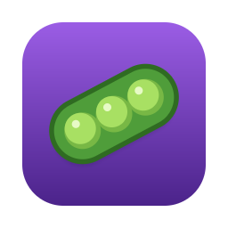

# Podman Tray

App de barra de menu para macOS, escrito em Go, para listar e controlar containers do Podman sem abrir o terminal.



## Recursos

- **Lista de containers** (`podman ps -a`) com status — 🟢 rodando, 🟡 pausado/reiniciando, ⚪️ parado, 🔴 erro, ⏳ ação em andamento — e contador `rodando/total` na barra de menu
- **Submenu por container**:
  - status, **CPU/memória** e imagem
  - **portas clicáveis**: `🌐 localhost:8080 → 80/tcp` abre `http://localhost:8080` no navegador (portas UDP aparecem, mas não são clicáveis)
  - **Start**, **Stop**, **Restart**
  - **Logs…** (`logs -f`), **Shell…** (`exec -it`, usa `bash` se existir, senão `sh`) e **Inspect…**, abertos no Terminal
- **Iniciar todos** / **Parar todos**: roda em paralelo e manda uma única notificação de resumo
- **Podman machine**: mostra o estado (🟢 rodando, 🟡 iniciando, ⚪️ parada), nome, CPUs e memória; só habilita **Iniciar** com a machine parada e **Parar** com ela rodando, e pede confirmação antes de parar
- **Notificações** nativas do macOS (com o ícone do app) ao concluir ações ou em caso de erro
- **Abrir ao iniciar sessão** via LaunchAgent (`~/Library/LaunchAgents/com.podman-tray.plist`)

### Como a lista se mantém atualizada

- O app escuta `podman events` e atualiza o menu assim que um container muda de estado. Com o stream ativo, o polling cai para 60s, só como garantia.
- Sem o stream, faz polling a cada 5s. Se o podman estiver inacessível (ex.: machine parada), as tentativas se espaçam de 5s até 60s.
- CPU/memória (`podman stats`) só são buscados enquanto o menu está em uso: a cada 2s durante os 30s após abrir o menu. A CPU é calculada pela variação de `cpu_time` entre amostras, ou seja, é o uso atual.

## Requisitos

- macOS 12 ou superior
- [Podman](https://podman.io) instalado (Homebrew, instalador oficial ou `/usr/local/bin`) e uma Podman machine configurada
- Go 1.27+ (só para compilar)

## Instalação

```bash
make install
```

Compila, gera `dist/Podman Tray.app`, copia para `~/Applications` e abre. Para ligar a inicialização automática, marque **Abrir ao iniciar sessão** no menu.

Na primeira execução o macOS pede permissão para o app enviar notificações. Na primeira vez que usar **Logs…**, **Shell…** ou **Inspect…**, pede também permissão para controlar o Terminal.

Para remover (app e LaunchAgent):

```bash
make uninstall
```

## Distribuição (DMG)

```bash
make dmg   # → dist/Podman-Tray-<versão>.dmg
```

Gera um DMG de arrastar para instalar (o app + atalho para `/Applications`), com binário universal (Apple Silicon + Intel).

**Versão.** A versão vem de `CFBundleShortVersionString` no `packaging/Info.plist`: altere lá antes de gerar um release. Cada build recebe também um número com data e hora (`CFBundleVersion`, ex. `202610152041`). A versão aparece no fim do menu (`Podman Tray 1.0.0`) e no tooltip do ícone; o build fica no **Obter Informações** do Finder.

**Assinatura.** Por padrão o app recebe assinatura *ad-hoc*: funciona nesta máquina, mas em outro Mac o Gatekeeper bloqueia o app baixado. Para liberar, quem recebe vai em **Ajustes do Sistema → Privacidade e Segurança → Abrir Mesmo Assim**, ou roda:

```bash
xattr -dr com.apple.quarantine "/Applications/Podman Tray.app"
```

Para distribuir sem esse aviso, é preciso uma conta no [Apple Developer Program](https://developer.apple.com/programs/) (US$ 99/ano):

1. Crie um certificado **Developer ID Application** (Xcode → Settings → Accounts → Manage Certificates).
2. Salve as credenciais do notarytool uma vez (use uma *app-specific password* do appleid.apple.com):
   ```bash
   xcrun notarytool store-credentials podman-tray --apple-id voce@exemplo.com --team-id TEAMID
   ```
3. Gere o DMG assinado, notarizado e com o ticket anexado (*stapled*):
   ```bash
   make dmg SIGN_IDENTITY="Developer ID Application: Seu Nome (TEAMID)" NOTARY_PROFILE=podman-tray
   ```

Com identidade, o app é assinado com *hardened runtime* e o entitlement `com.apple.security.automation.apple-events` (`packaging/entitlements.plist`), necessário para abrir o Terminal via AppleScript.

## Desenvolvimento

```bash
make run        # roda direto com go run
make test       # testes
make vet        # go vet
make build      # só o binário nativo em bin/podman-tray
make universal  # binário universal em bin/podman-tray-universal
make app        # gera "dist/Podman Tray.app" (universal, assinatura ad-hoc)
make icon       # regenera packaging/AppIcon.icns (e o .png do README) a partir de tools/genicon
make clean      # remove bin/ e dist/
```

A opção **Abrir ao iniciar sessão** fica desabilitada no `make run`, porque o binário do `go run` vive num diretório temporário.

### Estrutura

```
cmd/podman-tray/      # main: só inicia o systray
internal/podman/      # wrapper do CLI do podman: containers, stats, events, machine
internal/macos/       # notificações e diálogo nativos (Objective-C), Terminal, navegador, LaunchAgent
internal/tray/
  app.go              # ciclo de vida e loop de atualização (intervalos e backoff)
  events.go           # stream de `podman events` com reconexão e debounce
  menu.go             # montagem e atualização do menu
  actions.go          # start/stop/restart, ações em lote, machine, login item
  stats.go            # cálculo de CPU/memória
  icon.go             # ícone da barra de menu (desenhado em código)
tools/genicon/        # gerador do ícone do app
packaging/            # Info.plist, entitlements.plist e AppIcon.icns do bundle (+ AppIcon.png do README)
```

O menu só é recriado quando muda o conjunto de containers (ou suas portas) ou o estado de erro; nas demais atualizações, os itens existentes são editados no lugar.

## Solução de problemas

- **"podman não encontrado no PATH"**: apps abertos pelo Finder recebem um PATH mínimo. O app procura também em `/opt/homebrew/bin`, `/usr/local/bin` e `/opt/podman/bin`; se o podman estiver em outro lugar, adicione o caminho em `internal/podman/client.go`.
- **"⚠️ Podman indisponível"**: normalmente a machine está parada. Use **▶ Iniciar Podman machine** no menu.
- **Notificações com o ícone do Editor de Scripts**: o app só envia notificações próprias (com o ícone dele) quando tem permissão; sem ela, usa o `osascript`. Libere em **Ajustes do Sistema → Notificações → Podman Tray** — vale na hora, sem reiniciar. No `make run` (fora do `.app`) é sempre `osascript`.
  Se o pedido de permissão nunca aparece, o macOS pode estar com um registro antigo do app: `make install` já limpa isso, mas dá para conferir com `lsregister -dump | grep -A3 com.podman-tray`.
- **Ícone genérico no Finder/Dock** depois de instalar: cache do macOS. Rode `killall Finder Dock`.
- **Login item depois de mover o app**: dentro do `.app`, o LaunchAgent abre o app pelo bundle id (`open -b com.podman-tray`), então mover o app não quebra nada. Fora do bundle, o app reescreve o LaunchAgent sozinho ao iniciar.
